<p align="center">
  
</p>


<div align="center">
  <a href="https://git.io/typing-svg">
   

  </a>
</div>

<div align="center">
  
  <a href="https://github.com/Niczzxo?tab=followers"></a>
  
  
</div>

<br/>

## 👨‍💻 Riyazul Islam, MERN Stack and Full-Stack Developer

### 🚀 About Me
I am **Riyazul Islam**, a **MERN Stack and Full-Stack Developer, AI Developer, Apps Developer, and UI/UX Designer** from Dhaka, Bangladesh 🇧🇩, with **3+ years of experience** and **30+ completed projects**. I build scalable, high-performance web applications, Android apps and AI-powered products, bridging aesthetics and functionality so every product is visually compelling, user-centric and ready for real-world demands.

Currently, I work as a **Full-Stack Developer (MERN)** on freelance projects for clients, and I am pursuing a **Diploma in Computer Science and Technology** at **Dhaka Polytechnic Institute** (2023 to Present).

---

### 🔭 What I Am Doing Now
- 💼 **Current Role:** **Full-Stack Developer (MERN)**, Freelance, since January 2023.
- 🚀 **Latest Launch:** **CashSkill Decoder**, an AI-powered tool for USA survey work, live at cashskilldecoder.tech.
- 📱 **Android Apps:** **Aello Music** and **EditGo**, built with **Kotlin** and **Jetpack Compose**.
- 🎓 **Education:** **Diploma in Computer Science and Technology**, Dhaka Polytechnic Institute, 2023 to Present.
- 🎯 **Current Focus:** AI integration with **Gemini AI** and **Mistral AI**, and premium UI/UX with smooth motion.

---

### 💡 Core Stack
- **Frontend:** Interactive, animated UIs with **React.js**, **Next.js**, **TypeScript** and **Tailwind CSS**.
- **Backend:** Secure REST APIs with **Node.js**, **Express** and **JWT** authentication.
- **Database and Cloud:** **MongoDB**, **PostgreSQL**, **Supabase**, **Firebase** and **Redis**.
- **Mobile:** Native Android apps with **Kotlin** and **Jetpack Compose**.
- **AI:** **Gemini AI** and **Mistral AI** integration, with prompt engineering.

> **⚡ Philosophy:** "First, solve the problem. Then, write the code."

---

---

<!-- Tech Stack Section -->

<h1 align="center">🛠️ Tech Stack</h1>

<h2 align="center">💻 Programming Languages</h2>

<p align="center">
   &nbsp;&nbsp;&nbsp;  &nbsp;&nbsp;&nbsp;  &nbsp;&nbsp;&nbsp;  &nbsp;&nbsp;&nbsp;  &nbsp;&nbsp;&nbsp; 
</p>

<h2 align="center">🌐 Frontend Development</h2>

<p align="center">
   &nbsp;&nbsp;&nbsp;  &nbsp;&nbsp;&nbsp;  &nbsp;&nbsp;&nbsp; <picture><source media="(prefers-color-scheme: dark)" srcset="https://cdn.simpleicons.org/nextdotjs/FFFFFF" /></picture> &nbsp;&nbsp;&nbsp;  &nbsp;&nbsp;&nbsp; 
</p>
<p align="center">
   &nbsp;&nbsp;&nbsp;  &nbsp;&nbsp;&nbsp; 
</p>

<h2 align="center">🔧 Backend Development</h2>

<p align="center">
   &nbsp;&nbsp;&nbsp; <picture><source media="(prefers-color-scheme: dark)" srcset="https://cdn.simpleicons.org/express/FFFFFF" /></picture> &nbsp;&nbsp;&nbsp;  &nbsp;&nbsp;&nbsp;  &nbsp;&nbsp;&nbsp;  &nbsp;&nbsp;&nbsp; 
</p>

<h2 align="center">🗄️ Databases and Cloud</h2>

<p align="center">
   &nbsp;&nbsp;&nbsp;  &nbsp;&nbsp;&nbsp;  &nbsp;&nbsp;&nbsp;  &nbsp;&nbsp;&nbsp;  &nbsp;&nbsp;&nbsp; 
</p>

<h2 align="center">🤖 AI Development</h2>

<p align="center">
   &nbsp;&nbsp;&nbsp; 
</p>

<h2 align="center">📱 Mobile Development</h2>

<p align="center">
   &nbsp;&nbsp;&nbsp;  &nbsp;&nbsp;&nbsp; 
</p>

<h2 align="center">🎨 Design and Tools</h2>

<p align="center">
   &nbsp;&nbsp;&nbsp;  &nbsp;&nbsp;&nbsp;  &nbsp;&nbsp;&nbsp; <picture><source media="(prefers-color-scheme: dark)" srcset="https://cdn.simpleicons.org/github/FFFFFF" /></picture> &nbsp;&nbsp;&nbsp;  &nbsp;&nbsp;&nbsp; 
</p>

<h2 align="center">🚀 Deployment and Hosting</h2>

<p align="center">
  <picture><source media="(prefers-color-scheme: dark)" srcset="https://cdn.simpleicons.org/vercel/FFFFFF" /></picture> &nbsp;&nbsp;&nbsp;  &nbsp;&nbsp;&nbsp;  &nbsp;&nbsp;&nbsp;  &nbsp;&nbsp;&nbsp;  &nbsp;&nbsp;&nbsp; 
</p>

---

<br/>

<h2 align="center">🌐 Connect with Me:</h2>

<p align="center">
  <a href="https://linkedin.com/in/md-riyazul-islam-rafsan/" target="_blank">
    
  </a> &nbsp;
  <a href="https://facebook.com/Riyazul.Islam.Rafsan" target="_blank">
    
  </a> &nbsp;
  <a href="https://discord.com/users/Niczzxo" target="_blank">
    
  </a> &nbsp;
  <a href="https://instagram.com/Niczzxo" target="_blank">
    
  </a> &nbsp;
  <a href="mailto:hello@riyazulislam.dev">
    
  </a> &nbsp;
  <a href="https://www.riyazulislam.dev" target="_blank">
    
  </a>
</p>

---

## 📊 GitHub Analytics: Niczzxo

<p align="center">
  
</p>

<div align="center">
  
</div>

<h3 align="center">📈 Statistics Summary</h3>

<div align="center">
  
  
  <br/>
  
  

</div>

<div align="center">
<!--START_SECTION:waka-->

```rust
From: 19 April 2026 - To: 30 October 2026

Total Time: 9 hrs 4 mins

JavaScript   4 hrs 24 mins         ⣿⣿⣿⣿⣿⣿⣿⣿⣿⣿⣿⣿⣷⣀⣀⣀⣀⣀⣀⣀⣀⣀⣀⣀   47.24 %
Bash         1 hr 11 mins          ⣿⣿⣿⣿⣄⣀⣀⣀⣀⣀⣀⣀⣀⣀⣀⣀⣀⣀⣀⣀⣀⣀⣀⣀⣀   12.69 %
Markdown     41 mins               ⣿⣷⣀⣀⣀⣀⣀⣀⣀⣀⣀⣀⣀⣀⣀⣀⣀⣀⣀⣀⣀⣀⣀⣀⣀   07.48 %
HTML         17 mins               ⣷⣀⣀⣀⣀⣀⣀⣀⣀⣀⣀⣀⣀⣀⣀⣀⣀⣀⣀⣀⣀⣀⣀⣀⣀   03.07 %
Other        15 mins               ⣶⣀⣀⣀⣀⣀⣀⣀⣀⣀⣀⣀⣀⣀⣀⣀⣀⣀⣀⣀⣀⣀⣀⣀⣀   02.84 %
```

<!--END_SECTION:waka-->
</div>
<br/>

<div align="center">
  
</div>


---

### 🕹️ Contribution Activity

> Chomp, chomp! Watch my GitHub contributions power up!

<br clear="both">

<picture>
  <source media="(prefers-color-scheme: dark)" srcset="https://raw.githubusercontent.com/Niczzxo/Niczzxo/output/pacman-contribution-graph-dark.svg">
  <source media="(prefers-color-scheme: light)" srcset="https://raw.githubusercontent.com/Niczzxo/Niczzxo/output/pacman-contribution-graph.svg">
  
</picture>

<br clear="both">

---

### 🧠 Quote of the Day
<p align="center">
  
</p>

<br/>

<div align="center">
  
  <br/>
  <b>💻 Crafted with ☕ by Riyazul Islam</b>
</div>
